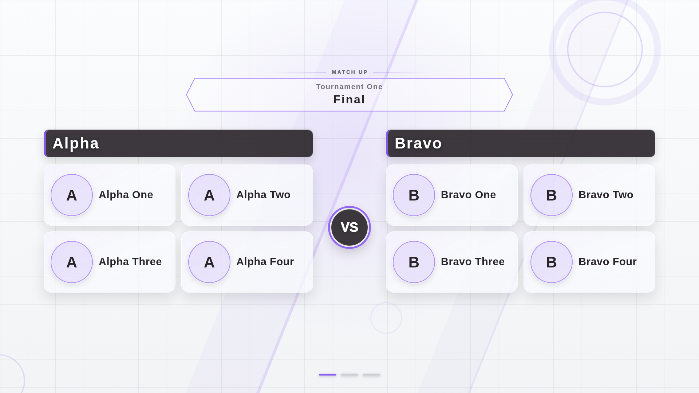
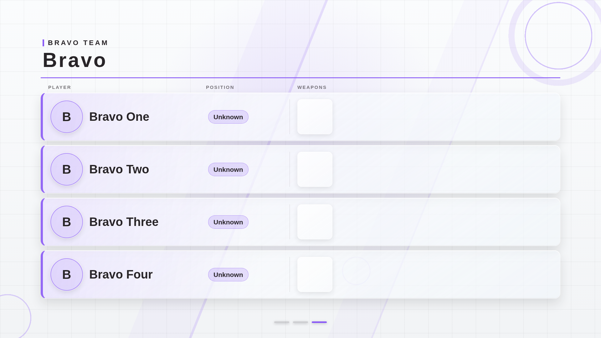

# 背景の通常／軽量モード比較（Issue #51）

## 実装

Dock の「表示設定 → 背景モード」で通常（アニメーション）と軽量（静止）を選択する。
軽量では背景2層の `animation` を `none`、`will-change` を `auto` にする。
背景のグラデーション、色、要素のサイズ・配置の定義は共通で、通常は従来の20秒／24秒周期で動く。
静止背景は transform を持たない基準位置を使うため、通常モードの任意の瞬間とは模様の位置が異なる。

設定は既存の BroadcastChannel と localStorage で同期・復元する。
旧データや不正なモード値は通常として扱う。モードは対戦データの取得キーやカルーセルのキーに含めない。
ステージ紹介中は既存の表示設定と同じく終了後に反映し、動画と紹介ラベルの演出は変更しない。

## Chromium での測定方法

- production build を `vite preview` で配信し、Overlay 1ページだけを開く。Dock／Debugは測定中に開かない。
- Linux arm64、同梱 Chromium、headless、1920×1080、deviceScaleFactor=1、reduced motion の指定なし。
- 同一の `fixture-data.ts` の対戦データと画像を使用する。実大会データではない。
- 各回で同じ専用ページを再読み込みして状態を初期化し、18秒のウォームアップで両チームの画像・フォントを読み込む。
- 通常→軽量、軽量→通常、通常→軽量の順序で各3回、各32秒間測定する。
- renderer CPU は CDP `SystemInfo.getProcessInfo` の累積 `cpuTime` の差分。専用ブラウザ内の renderer プロセス全スレッドの合計であり、main thread だけの値ではない。
- GPUプロセスCPUも同様にプロセス全スレッドのCPU時間差分を記録する。GPUハードウェア使用率ではない。
- Task は CDP `Performance.getMetrics` の `TaskDuration`。Style と Layout も同じメトリクスの差分。
- Paint／PrePaint は CDP trace の完了イベント（`ph: X`）の処理時間の合計。trace と CPU の取得には測定自体の負荷もある。
- ウォームアップ後のカルーセル用タイマー発火数（trace の `TimerFire`）と通信件数も記録し、表示条件を確認する。
- アクティブなスライド要素のDOM挿入数も補助記録する。Reactによる要素移動を含むため、スライド切替回数そのものではない。
- FPS、GPU使用率、共有 VizCompositorThread のCPU時間は測定しない。

再現コマンド（リポジトリルート）:

```sh
bun install --frozen-lockfile
CI=true bun run scripts/prepare-ci-fixtures.ts
VITE_API_URL=http://127.0.0.1:3000 bun run --filter web build
cd apps/web
bun run vite preview --host 127.0.0.1 --port 5175
# 別ターミナルで apps/web から実行
OVERLAY_MEASURE_ORIGIN=http://127.0.0.1:5175 bun run scripts/measure-background-mode.ts /tmp/background-mode-performance
```

スクリプトは結果JSON、各回のtrace JSON、通常／軽量の比較画像を指定先へ保存する。
画像取得は測定区間の外で行う。trace は大きいためGitには含めない。

## Chromium の測定結果（2026-10-19 UTC）

Chromium **153.0.8010.12**、Bun 1.4.2、Linux arm64。
GPU情報は **ANGLE / SwiftShader 5.0.0**、`gpu_compositing: disabled_software`。
ハードウェアGPUを使用した環境の記録ではない。

以下は全6回の記録。時間は小数点以下3桁へ丸めた。

| 実行 | モード | 区間秒 | renderer CPU秒 | GPUプロセスCPU秒 | main Task ms | タイマー発火数 |
| --- | --- | ---: | ---: | ---: | ---: | ---: |
| 1 | 通常 | 32.003 | 2.210 | 12.000 | 14289.869 | 4 |
| 2 | 軽量 | 32.009 | 1.670 | 2.910 | 21266.105 | 3 |
| 3 | 軽量 | 32.003 | 2.210 | 3.640 | 6069.459 | 4 |
| 4 | 通常 | 32.004 | 1.970 | 14.330 | 9753.992 | 3 |
| 5 | 通常 | 32.003 | 0.680 | 5.660 | 19708.687 | 2 |
| 6 | 軽量 | 32.002 | 2.910 | 1.930 | 17083.764 | 2 |

| 実行 | Style回数 / ms | Layout回数 / ms | Paint ms | PrePaint ms | 通信件数 |
| --- | ---: | ---: | ---: | ---: | ---: |
| 1 | 27 / 35.479 | 3 / 48.157 | 25.260 | 23.947 | 0 |
| 2 | 7 / 17.993 | 2 / 31.744 | 24.967 | 5.133 | 0 |
| 3 | 11 / 13.039 | 3 / 36.811 | 14.770 | 8.283 | 0 |
| 4 | 25 / 55.403 | 3 / 33.298 | 16.327 | 20.330 | 0 |
| 5 | 8 / 11.096 | 1 / 14.234 | 5.651 | 3.693 | 0 |
| 6 | 6 / 13.421 | 2 / 43.424 | 11.057 | 6.604 | 0 |

全回で測定区間中の通信は0件。GPUプロセスCPU時間は通常 **5.66〜14.33秒**、軽量 **1.93〜3.64秒** だった。
同じ設定・データで反復したが、タイマー発火は2〜4回と揃わず、main Taskの処理時間にも大きなばらつきがある。
renderer CPUは軽量側が常に小さいわけではなく、Paint・Layoutの一律の改善も確認できていない。
したがって、背景の継続的な合成負荷が減る傾向を示す参考記録として扱い、背景だけの削減率やOBSでの改善率は算出しない。
`TaskDuration` はタスクの経過処理時間であり、renderer CPU時間と同じ指標ではない。

生の数値と主要なブラウザ情報（GPU情報はデバイスと合成方式を抜粋）: [background-mode-results.json](./background-mode-results.json)。
trace JSONは再現コマンドで生成できる。今回の実行では `/tmp/inkling-issue-51-performance-reload/` に保存した。

### 見た目と機能

背景2層のグラデーションと色の計算値がモード間で同じこと、軽量時のtransformが変化しないこと、
通常へ戻すとtransformが再び変化することをE2Eで確認した。
API呼出数、カルーセルの進行、別ページとDebugへの同期、再読込、ステージ紹介の再生と終了後の設定反映も確認した。

以下は測定終了後の参考画像。撮影時のスライド位置は異なるため、前景全体のピクセル比較には使わない。
背景のリング・斜線・グリッドと色を維持していることを目視で確認した。

| 通常 | 軽量 |
| --- | --- |
|  |  |

## OBS / CEF

この環境にはOBS StudioとそのBrowser Source／CEF実行環境がないため、未測定。
Chromiumで得た削減率をOBSでのCPU、GPU、FPSの改善率として扱わない。
実機では1920×1080、同一のBrowser Source設定・FPS・大会・スライド進行で通常／軽量を各3回以上比較し、
OBS/CEFのバージョン、CPU時間、描画処理、映像、録画・配信の有無を別途記録する必要がある。
